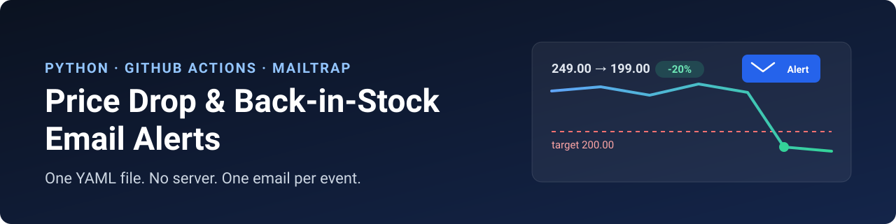
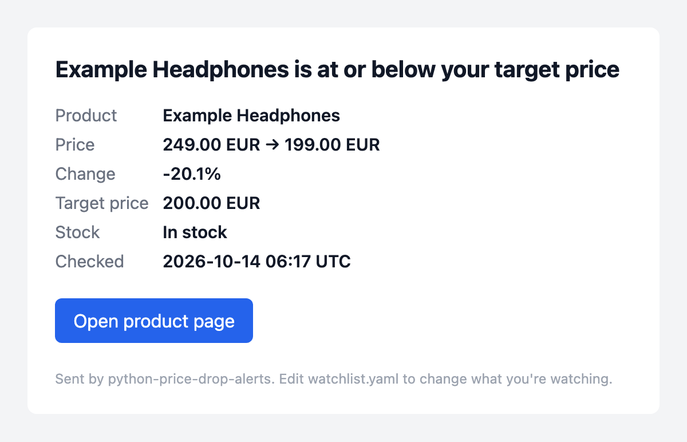
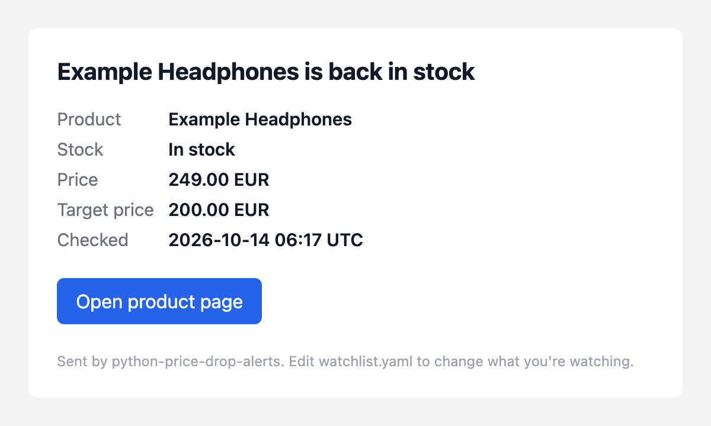
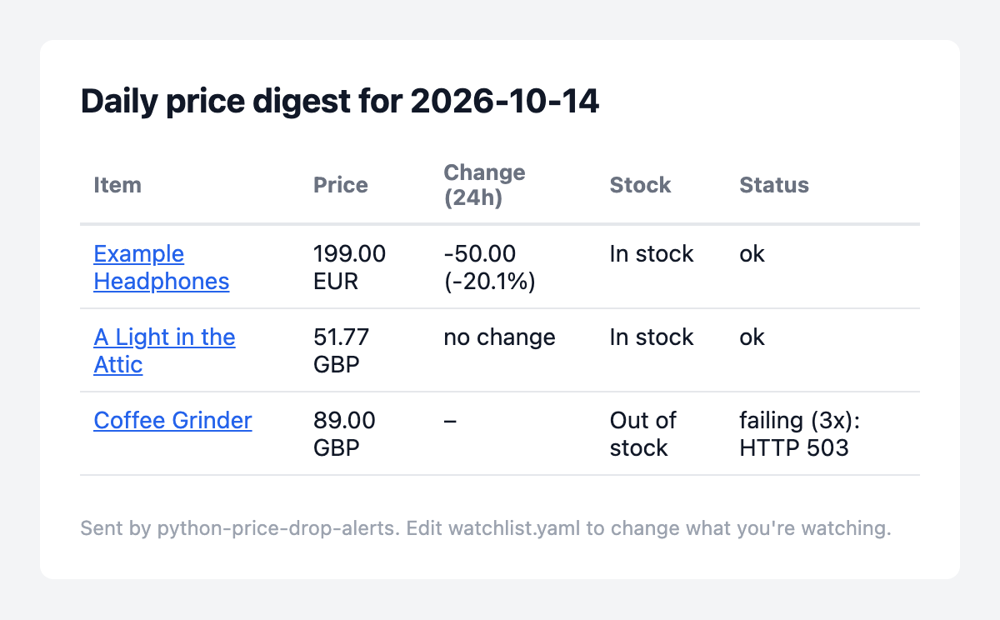
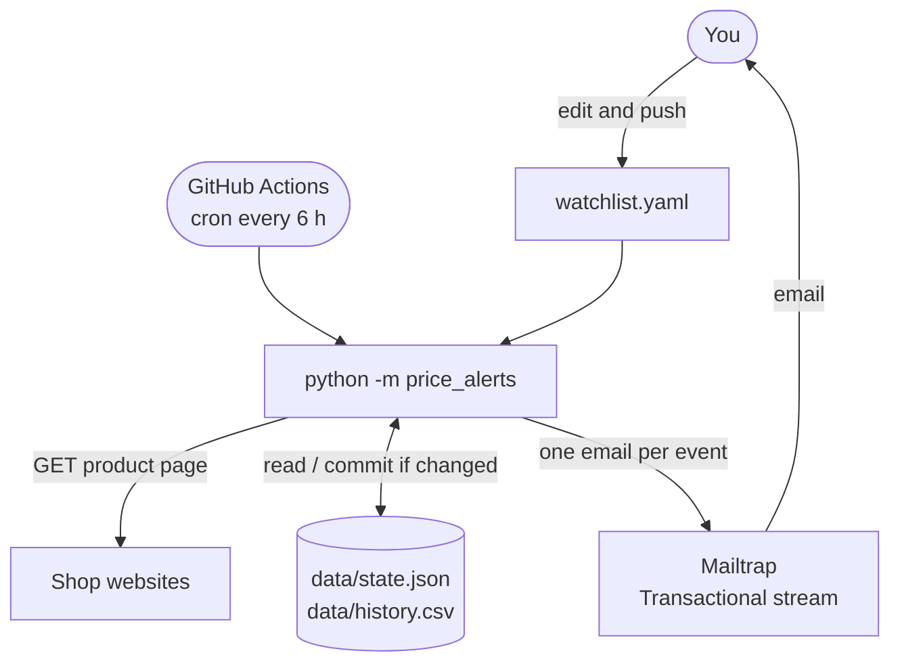
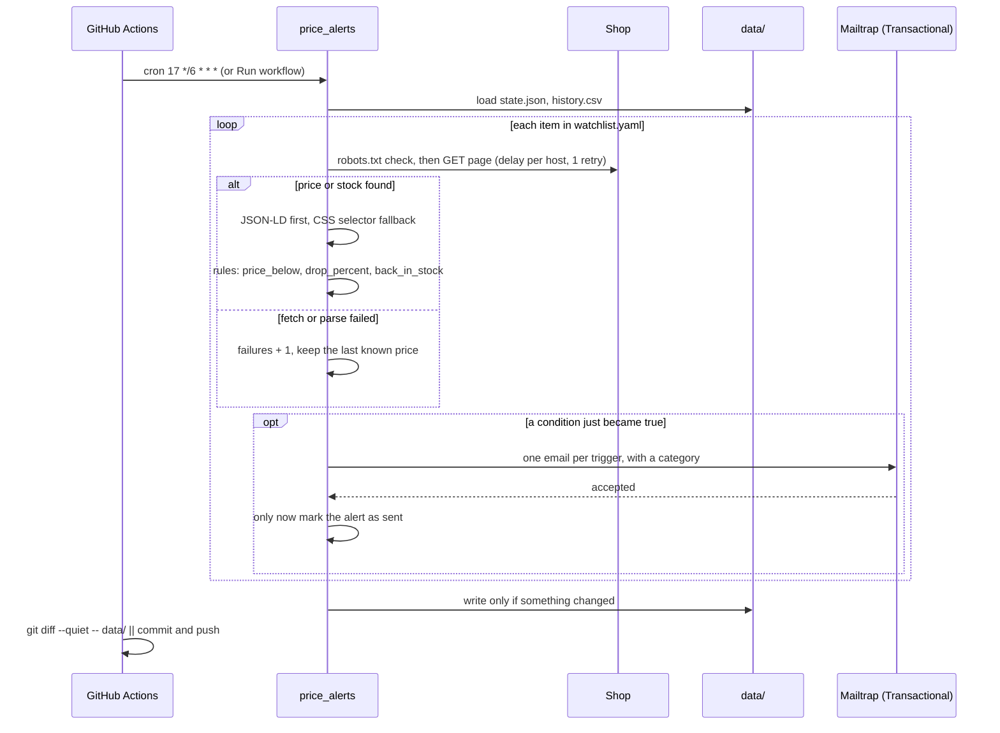

<p align="center">
  
</p>

# Price Drop and Back-in-Stock Email Alerts with Python and GitHub Actions

A free price tracker that runs on GitHub Actions: list the products you care about in a YAML file and get one email when the price drops or the item is back in stock. Written in Python 3.12, it reads schema.org product data, remembers what it already told you, and sends alerts through the Mailtrap Email API.

<p>
  
  
  
  
  
  
</p>

**Contents:** [Demo](#demo) · [How it works](#how-it-works) · [Features](#features) · [Stack](#stack) · [Prerequisites](#prerequisites) · [Mailtrap setup](#mailtrap-setup) · [Quick start](#quick-start) · [Alert rules](#alert-rules) · [Key integration points](#key-integration-points) · [Failure behavior](#failure-behavior) · [Configuration](#configuration) · [Run locally](#run-locally) · [Data files](#data-files) · [Project structure](#project-structure) · [Tests](#tests) · [Scrape responsibly](#scrape-responsibly) · [Limitations](#limitations) · [FAQ](#faq)

## Demo

| Price drop | Back in stock | Daily digest |
| --- | --- | --- |
|  |  |  |

The screenshots are `src/price_alerts/templates.py` rendered with sample data. Every email also has a plain-text version. A real run on GitHub Actions looks like this:

```text
INFO    A Light in the Attic: 51.77 GBP, in stock (via selector)
INFO    Sent price-alert email to you@example.com: Price alert: A Light in the Attic is 51.77 (target 60.00)

Summary
  Items checked: 1
  OK:            1
  Failed:        0
  Alerts sent:   1
```

## How it works

There is no server and no database. A scheduled GitHub Actions workflow runs a Python script every 6 hours. The script reads your watchlist, checks each product page, emails you through Mailtrap, and commits its memory (two small files in `data/`) back to the repo.



| Part | What it does | Where |
| --- | --- | --- |
| CLI | Arguments, `.env` loading, exit codes | `src/price_alerts/cli.py` |
| Config | Loads and validates `watchlist.yaml` with pydantic, with clear error messages | `src/price_alerts/config.py`, `models.py` |
| Fetcher | httpx with a clear User-Agent, per-host delay, one retry, robots.txt check | `src/price_alerts/fetch.py` |
| Extractor | schema.org Product JSON-LD first, CSS selector fallback | `src/price_alerts/extract.py` |
| Price parser | `"1.299,00 €"`, `"$1,299.99"`, `"₹1,29,999"` → `Decimal` + currency | `src/price_alerts/parse_price.py` |
| Rules | Pure functions that decide which alerts fire and how state changes | `src/price_alerts/rules.py` |
| State and history | Atomic, byte-stable `state.json` and an append-only `history.csv` | `src/price_alerts/state.py`, `history.py` |
| Templates | Plain-text and inline-styled HTML for every email, all values escaped | `src/price_alerts/templates.py` |
| Mailer | The only code that talks to Mailtrap | `src/price_alerts/mailer.py` |
| Runner | Orchestration with an injectable fetcher, mailer and clock | `src/price_alerts/runner.py` |

### One run, step by step



## Features

- **One email per event.** Each alert fires once, when its condition *becomes* true, and stays quiet until the condition resets. Unchanged prices mean no email and no commit.
- **Three alert types.** Get an email when the price reaches a target price, when it drops a set percentage, or when the item is back in stock. Each item can use any combination.
- **Reads structured data first.** It parses schema.org `Product` JSON-LD, which most shops publish for Google, before falling back to your CSS selector. It handles:
  - `@graph`, top-level lists, and `@type` given as a list
  - `Offer`, offer lists and `AggregateOffer`
  - every way of writing `availability`
- **Understands real-world prices.** It reads `1.299,00 €`, `$1,299.99`, `1 299,00 zł`, `₹1,29,999`, `Rs. 2,499.00`, `EUR 49` and more, using `Decimal` (never float).
- **Failed sends are retried.** If Mailtrap rejects an email, the alert isn't marked as sent and is retried on the next run.
- **Tells you when a watcher breaks.** After 3 failed checks in a row you get one email with the error and a hint, and nothing more until the check works again.
- **Optional daily digest.** At most one email per UTC day with every item's price, 24-hour change, stock and status.
- **Dry run.** Fetch and evaluate everything, save each email as HTML to `out/`, send nothing, and leave `data/` untouched.
- **Polite by default.** It identifies itself in the User-Agent, waits between requests to the same host, and respects `robots.txt`.
- **One secret.** The only secret is `MAILTRAP_API_TOKEN`. Everything else lives in `watchlist.yaml`.

## Stack

| | |
| --- | --- |
| Language | Python 3.12, standard library for JSON, CSV, `Decimal`, `urllib.robotparser`, `argparse` and logging |
| HTTP | [httpx](https://www.python-httpx.org/) |
| HTML parsing | [selectolax](https://github.com/rushter/selectolax) (Lexbor backend) |
| Config validation | [pydantic v2](https://docs.pydantic.dev/) |
| Watchlist | YAML via PyYAML |
| Email | [`mailtrap`](https://github.com/railsware/mailtrap-python) Python SDK, Transactional stream |
| Scheduler | GitHub Actions cron |
| Tests | pytest |

The only runtime dependencies are httpx, selectolax, pydantic, PyYAML and mailtrap. There is no database, no `requests` or BeautifulSoup in the code, and no python-dotenv (a ten-line stdlib loader reads `.env`).

## Prerequisites

- A GitHub account. Actions minutes are free for public repos, and private repos get a monthly allowance. This workflow uses about 4 minutes a day (4 runs, each under a minute).
- A [Mailtrap](https://mailtrap.io) account. The free plan is enough.
- Python 3.12, only if you want to run it on your own computer.

## Mailtrap setup

1. **Create an API token.** In Mailtrap, go to Settings, API Tokens, and create a token with access to your sending domain.
2. **First run on the demo domain.** New accounts get a demo sending domain, `demomailtrap.co`. Set `from_email: alerts@demomailtrap.co` and put your Mailtrap account email in `default_recipients`. The demo domain delivers only to the account owner, which is exactly what a personal price tracker needs. Mail from a shared demo domain often lands in spam, so check there for the first email.
3. **Verify your own domain to email anyone.** Add your domain under Sending Domains and create the DNS records Mailtrap shows (SPF, DKIM and DMARC). Then set `from_email` to an address on it. If the sender isn't on one of your domains, Mailtrap answers `Unauthorized` even when the token is valid.
4. **Know the free plan limits.** The free plan allows 4,000 emails a month and 150 a day. A price tracker sends a handful a week. See [Mailtrap sending limits](https://docs.mailtrap.io/email-api-smtp/setup/sending-limits).

## Quick start

1. **Create your copy.** Click **Use this template** (or **Fork**) at the top of this repo.
2. **Add the secret.** In your repo, go to **Settings → Secrets and variables → Actions → New repository secret**. Set the name to `MAILTRAP_API_TOKEN` and the value to your token.
3. **Edit `watchlist.yaml`.** Set `from_email` (see [Mailtrap setup](#mailtrap-setup)), set `default_recipients` to your inbox, and replace the example item with your products. Commit the change.
4. **Run the workflow.** Open the **Actions** tab and enable workflows if GitHub asks. Then choose **Price alerts → Run workflow**.
5. **Get your first alert.** The first run records baselines (the current price and stock), so it usually sends nothing. To test right away, set an item's `target_price` *above* its current price with `notify_on: [price_below]`, and run the workflow again.

From then on, the workflow runs every 6 hours (`17 */6 * * *`, off the hour because runs at `:00` are often delayed) and commits price changes to `data/` as `github-actions[bot]`.

## Alert rules

Every rule fires **once when its condition becomes true** and stays quiet until it resets. The rules are pure functions in [`src/price_alerts/rules.py`](src/price_alerts/rules.py).

| Rule | Fires when | Resets when |
| --- | --- | --- |
| `price_below` | price ≤ `target_price`. This can fire on the first check. | price goes back above `target_price` |
| `drop_percent` | price ≤ baseline × (1 − `drop_percent`/100). The baseline is the first price seen, which never fires. | After an alert, the baseline moves to the new price. If the price rises above the baseline, the baseline moves up too. |
| `back_in_stock` | stock changes from out of stock to in stock. Not on the first check, and not from "unknown". | the item goes out of stock again |
| watcher error | 3 failed checks in a row | the next successful check |

Example with `target_price: 200` and `drop_percent: 10`:

| Run | Price | Stock | Emails |
| --- | --- | --- | --- |
| 1 | 249.00 | in stock | none: baselines recorded |
| 2 | 249.00 | in stock | none: nothing changed, no commit either |
| 3 | 199.00 | in stock | **Price drop** (`price_below`) and **Price drop** (`drop_percent`, -20%) |
| 4 | 189.00 | in stock | none: already below target, and only 5% below the new baseline |
| 5 | 189.00 | out of stock | none |
| 6 | 189.00 | in stock | **Back in stock** |
| 7 | 210.00 | in stock | none: `price_below` re-arms |
| 8 | 195.00 | in stock | **Price drop** (`price_below`) |

Every email has a Mailtrap category, so the types are easy to tell apart in Mailtrap stats:

| Email | Stream | Category | Subject |
| --- | --- | --- | --- |
| Target price reached | Transactional | `price-alert` | `Price drop: Example Headphones 249.00 → 199.00 (-20.1%)` |
| Dropped by `drop_percent` | Transactional | `price-alert` | `Price drop: Example Headphones 249.00 → 199.00 (-20.1%)` |
| Back in stock | Transactional | `stock-alert` | `Back in stock: Example Headphones` |
| 3 failed checks in a row | Transactional | `watcher-error` | `Watcher error: Example Headphones failed 3 checks in a row` |
| Daily digest | Transactional | `digest` | `Price digest 2026-10-14: 3 items` |

## Key integration points

**One email, one stream.** The client is created without `bulk` or `sandbox`, so the SDK sends to the Transactional stream. Every email carries a category ([`src/price_alerts/mailer.py`](src/price_alerts/mailer.py)):

```python
import mailtrap as mt

client = mt.MailtrapClient(token=token)

client.send(mt.Mail(
    sender=mt.Address(email=from_email, name=from_name),
    to=[mt.Address(email=address) for address in message.to],
    subject=message.subject,
    text=message.text,
    html=message.html,
    category=message.category,   # price-alert, stock-alert, watcher-error, digest
))
```

**Mark an alert as sent only after Mailtrap accepts it.** The rules return each alert together with the state change that marks it sent (`on_sent`). The runner applies that change only when the send succeeds, so a failed send is retried on the next run instead of being lost ([`src/price_alerts/runner.py`](src/price_alerts/runner.py)):

```python
evaluation = evaluate(item, prev, result)
new_state = evaluation.state
for alert in evaluation.alerts:
    message = build_alert_email(item, alert, watchlist.recipients_for(item), now)
    if deliver(message):
        new_state = apply_sent(new_state, alert)   # e.g. {"price_below_active": True}
```

**Unchanged prices produce no diff.** `last_checked` is only bumped when something about the item actually changed, `state.json` is written with sorted keys and only if its content differs, and `history.csv` gets a row only when the price or stock changed:

```python
if new_state != prev:
    new_state = new_state.updated(last_checked=now_iso)
```

That is what makes the workflow's commit step a no-op on quiet runs:

```bash
if git diff --quiet -- data/; then
  echo "No price or state changes."
  exit 0
fi
git add data/
git commit -m "chore: update price data [skip ci]"
```

**Structured data before selectors.** The extractor walks every `<script type="application/ld+json">` block, skips invalid JSON, finds the `Product` (top level, in a list, or in `@graph`), and picks the lowest in-stock offer. Your CSS `selector` is used only when that yields no price ([`src/price_alerts/extract.py`](src/price_alerts/extract.py)).

## Failure behavior

| Situation | What happens |
| --- | --- |
| Product page returns 4xx, times out, or has no price | The check counts as failed. The last known price and stock are kept, and `consecutive_failures` goes up by one. |
| 5xx or network error | One retry, then the same as above. |
| 3 failures in a row | One `watcher-error` email with the URL, the last error and a hint to check the URL or selector. No more until the check works again. |
| Check works again after failures | The counter and the warning reset silently. |
| `robots.txt` disallows the page | A failure with the reason "Blocked by robots.txt". |
| Mailtrap rejects or fails an email | The error is logged without the token, the alert is not marked as sent, other items continue, and the run exits with code `2`. The next run retries. |
| Mailtrap answers `Unauthorized` | Usually the sender isn't on a verified domain, or the token is wrong. |
| `MAILTRAP_API_TOKEN` missing | The run exits with code `1` before fetching anything. Use `--dry-run` to run without it. |
| Invalid `watchlist.yaml` | The run exits with code `1`, and each error names the item and the field. For example: `item 'Example Headphones': target_price: required when notify_on includes price_below`. |
| One item throws an unexpected error | It's recorded as a failure for that item, and the other items still run. |
| Page has stock info but no price (common on sold-out pages) | The check counts as a success, and stock alerts still work. |
| Workflow runs while another is running | The `concurrency` group queues it, so runs never overlap. |

## Configuration

### `watchlist.yaml`

```yaml
settings:
  from_email: alerts@yourdomain.com   # must be on a Mailtrap-verified sending domain
  from_name: Price Alerts
  default_recipients: [you@example.com]
  request_delay_seconds: 5            # delay between requests to the same host
  timeout_seconds: 20
  respect_robots_txt: true
  digest: false                       # DIGEST env var overrides
items:
  - name: Example Headphones
    url: https://example.com/product/123
    selector: ".price"                # optional CSS fallback for price
    stock_selector: ".availability"   # optional
    out_of_stock_text: ["out of stock", "sold out"]  # optional
    target_price: 199.99              # needed for price_below
    drop_percent: 10                  # needed for drop_percent
    notify_on: [price_below, drop_percent, back_in_stock]
    recipients: [you@example.com]     # optional, falls back to default_recipients
```

| Field | Purpose |
| --- | --- |
| `from_email`, `from_name` | Sender. The address must be on a domain verified in Mailtrap. |
| `default_recipients` | Where alerts and the digest go. Required unless every item has `recipients`. |
| `request_delay_seconds` | Minimum gap between requests to the same host. Default `5`. |
| `timeout_seconds` | HTTP timeout per request. Default `20`. |
| `respect_robots_txt` | Skip pages that `robots.txt` disallows. Default `true`. |
| `digest` | Daily summary email. Default `false`. |
| `name` | Unique. Its slug (`example-headphones`) is the item's key in `state.json`, so if you rename an item, its history starts over. |
| `url` | An `http(s)` product page. |
| `selector`, `stock_selector`, `out_of_stock_text` | CSS fallback for the price and stock text. The text matching ignores case. |
| `target_price` | Required for `price_below`. |
| `drop_percent` | Required for `drop_percent`. Must be greater than 0 and less than 100. |
| `notify_on` | Any of `price_below`, `drop_percent`, `back_in_stock`. Default: every rule the item has numbers for, plus `back_in_stock`. |
| `recipients` | Overrides `default_recipients` for this item. |

### Environment

| Variable | Purpose |
| --- | --- |
| `MAILTRAP_API_TOKEN` | Mailtrap API token. The only secret: a repository secret on GitHub, or `.env` locally. |
| `DIGEST` | `true` or `false`. Overrides `settings.digest`. On GitHub, set it as a repository **variable** (not a secret). |
| `DRY_RUN` | `true` is the same as `--dry-run`. The workflow sets it from the **dry_run** checkbox. |

### Finding a CSS selector

You only need one when the page has no schema.org price. Run `python -m price_alerts --dry-run --only "Item name" -v`: the log says `via json-ld` or `via selector`.

1. Right-click the price on the product page and choose **Inspect**.
2. Pick a stable class or attribute, such as `.product-price .amount` or `[itemprop="price"]`. Avoid generated classes like `.css-1x2y3z`.
3. Test it in the browser console: `document.querySelector(".product-price .amount").textContent`.
4. Put it in `selector`. If the element has a `content` attribute (`<meta itemprop="price" content="12.99">`), that value is used.

## Run locally

```bash
git clone https://github.com/manishgupta412/python-price-drop-alerts.git && cd python-price-drop-alerts
python3.12 -m venv .venv && source .venv/bin/activate
pip install -r requirements-dev.txt         # runtime deps + pytest, installs the package
cp .env.example .env                        # paste your MAILTRAP_API_TOKEN
python -m price_alerts --dry-run -v
python -m price_alerts
```

```text
python -m price_alerts [--watchlist watchlist.yaml] [--data-dir data] [--dry-run] [--only NAME] [-v]
```

- **`--dry-run`** fetches and evaluates everything and saves each email as `out/<timestamp>_<item>_<kind>.html`. It sends nothing and doesn't modify `data/`. On GitHub, tick **dry_run** in **Run workflow**; the previews are uploaded as the `email-previews` artifact.
- **`--only NAME`** checks one item, by name or id.
- **Exit codes:** `0` OK (failed product checks don't change it), `1` config error, `2` at least one email failed to send.
- **`.env`** is read only if it exists, never overrides real environment variables, and its values are never printed. It's git-ignored.

## Data files

Both files are committed by the workflow as `github-actions[bot]` with `chore: update price data [skip ci]`, and only when something changed.

- **`data/state.json`.** Per item: `last_price`, `last_currency`, `last_in_stock`, `consecutive_failures`, `error_alert_sent`, `last_error`, `price_below_active`, `drop_baseline_price` and `last_checked` (the last check that changed something), plus a top-level `last_digest_date`. It's written atomically (temp file + replace) with sorted keys.
- **`data/history.csv`.** `timestamp,item_id,name,price,currency,in_stock,source`, with one row each time the price or stock changed. Open it in a spreadsheet to chart prices.

To start over, set `state.json` to `{}` and keep only the header line of `history.csv`.

## Project structure

```text
.
├── .github/workflows/
│   ├── price-alerts.yml      cron every 6 h + manual run with dry_run, commits data/
│   └── tests.yml             pytest on push and pull request
├── data/                     state.json and history.csv (committed by the bot)
├── docs/                     banner and email screenshots
├── src/price_alerts/
│   ├── __main__.py  cli.py   python -m price_alerts, arguments, exit codes
│   ├── config.py             watchlist loading, .env loader, readable validation errors
│   ├── models.py             pydantic Settings/Item/Watchlist, FetchResult, EmailMessage
│   ├── fetch.py              httpx fetcher: User-Agent, per-host delay, retry, robots.txt
│   ├── extract.py            JSON-LD Product parsing, CSS selector fallback
│   ├── parse_price.py        price text → Decimal + currency
│   ├── rules.py              price_below, drop_percent, back_in_stock, failures (pure)
│   ├── state.py  history.py  state.json and history.csv
│   ├── templates.py          subject, plain text and HTML for every email
│   ├── mailer.py             Mailer protocol, MailtrapMailer
│   └── runner.py             orchestration with injectable fetcher, mailer and clock
├── tests/                    pytest suites + fixtures/ (saved product pages)
├── watchlist.yaml            what to watch and who to email
├── requirements.txt          pinned runtime deps
└── requirements-dev.txt      + pytest
```

`runner.run()` takes the fetcher, mailer and clock as arguments. That is what lets the tests run against saved HTML pages, a fake mailer and a fixed clock, with no network and no Mailtrap account.

## Tests

```bash
pip install -r requirements-dev.txt
pytest
```

The suite has 99 tests and needs no credentials or network. It covers:

- **Extraction:** every JSON-LD variant (simple, `@graph`, top-level list, offer list, `AggregateOffer`, out of stock) and the mapping of every availability value.
- **Fallbacks:** the CSS selector when JSON-LD is missing or broken, and a page with nothing parseable.
- **Price parsing:** a table of real-world formats, with garbage returning `None`.
- **Alert rules:** `price_below` fires once and re-arms, the `drop_percent` baseline, and `back_in_stock` only on a change from out of stock to in stock.
- **Acceptance:** two runs with unchanged prices send **zero** emails and leave `state.json` and `history.csv` byte-identical.
- **Failures:** 1 and 2 failures send nothing, the 3rd sends exactly one watcher error, the 4th sends none, and a success resets.
- **Email categories:** every email has the correct category, and values are HTML-escaped.
- **Dry run:** nothing is sent, `out/*.html` is written, and `data/` is untouched.
- **Send failures:** the alert isn't marked, and it's retried on the next run.
- **Config and fetcher:** validation messages, the `.env` loader, and the fetcher's retry, robots.txt and User-Agent (via `httpx.MockTransport`).

## Scrape responsibly

- **Check `robots.txt` and the site's terms of service.** `respect_robots_txt: true` (the default) skips disallowed pages. Turn it off only for sites you have permission to check.
- **Keep the frequency low.** Every 6 hours is plenty for prices, and `request_delay_seconds` spaces out requests to the same host.
- **Identify yourself.** Requests send `User-Agent: python-price-drop-alerts/1.0 (+https://github.com/manishgupta412/python-price-drop-alerts)`. If you fork, change it in `src/price_alerts/fetch.py` to your repo.
- **Don't scrape behind logins**, and don't try to get around blocks or CAPTCHAs.

## Limitations

- **JavaScript-rendered prices.** No browser runs here. If the price only appears after JavaScript runs and isn't in the JSON-LD, the tool can't see it. Many such shops still include JSON-LD in the HTML.
- **Sites that block bots.** Some shops return 403 or a CAPTCHA to non-browser clients or to cloud IP ranges, including GitHub's runners. You'll get one watcher-error email. Respect the block.
- **Scheduled workflows get disabled.** GitHub doesn't run scheduled workflows in forks until you enable Actions, and disables them in public repos with no activity for 60 days. Bot commits only happen when prices change. If the emails stop, check the Actions tab and re-enable the workflow.
- **Cron timing is approximate.** GitHub may delay scheduled runs at busy times.

## FAQ

### How do I get an email when a product's price drops?

Add the product to `watchlist.yaml` with a `target_price` (to be told when it reaches your price) or a `drop_percent` (to be told when it falls by that much), and add your `MAILTRAP_API_TOKEN` as a repository secret. The scheduled workflow checks every 6 hours, reads the price from the page's schema.org data or your CSS selector, and emails you once through Mailtrap when the condition is met. See [Quick start](#quick-start).

### How do I run a Python script on a schedule for free?

Use GitHub Actions with an `on: schedule` cron trigger, as [`.github/workflows/price-alerts.yml`](.github/workflows/price-alerts.yml) does with `cron: "17 */6 * * *"`. Public repos get free Actions minutes, and private repos get a monthly free allowance. Pick an off-the-hour minute, because runs at `:00` are often delayed. If the script needs memory between runs, commit a small state file back to the repo, as this project does with `data/`, so you need no database or server.

### How do I avoid sending the same alert twice?

Store whether each condition already fired, and alert only when it changes from false to true. Here, `price_below_active`, `drop_baseline_price`, `last_in_stock` and `error_alert_sent` in `data/state.json` record that, and each resets only when its condition does. The flag is set only after the email is accepted, so a failed send is retried instead of lost. Write the state deterministically (sorted keys, no timestamps that change every run) so quiet runs change nothing. See [Alert rules](#alert-rules).

### How do I send email from a Python script?

Use a transactional email API rather than SMTP from a runner. With the official Mailtrap SDK (`pip install mailtrap`), create a client with your API token and send an `mt.Mail` with a sender on your verified domain, recipients, a subject, text and HTML, and a category for stats. The full code is under [Key integration points](#key-integration-points), and [`src/price_alerts/mailer.py`](src/price_alerts/mailer.py) wraps it behind a small `Mailer` interface so tests can use a fake.

## License

[MIT](LICENSE)
